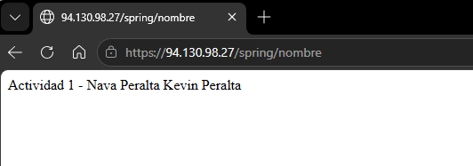
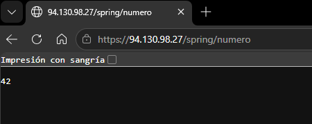
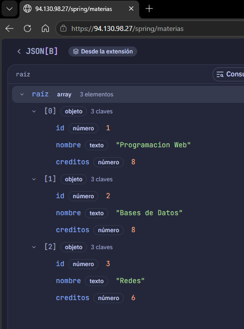

# Actividad 1 – API REST con Spring Boot

- **Alumno:** Nava Peralta Kevin Peralta
- **Materia:** Programación Web

## Descripción

Creación de una proyecto sencillo creado con **Spring Boot** y la dependencia **Spring Web**. Expone varios endpoints que devuelven texto, un número, una lista de objetos en formato JSON y una imagen. 


## Endpoints

| Método | Ruta | Controlador | Qué devuelve | Tipo de respuesta |
|---|---|---|---|---|
| GET | `/nombre` | `InfoController` | Texto con el nombre del proyecto y autor | `text/plain` |
| GET | `/numero` | `InfoController` | Un número entero | `text/plain` |
| GET | `/materias` | `MateriaController` | Lista de materias | `application/json` |

### 1. `GET /nombre`
Devuelve un texto con el nombre del proyecto y del autor, para identificar de quién es cada instancia corriendo en el servidor.

```java
@RestController
public class InfoController {

    @GetMapping("/nombre")
    public String getNombre() {
        return "Actividad 1 - Nava Peralta Kevin";
    }
}
```

**Cómo funciona:**

- `@RestController` le indica a Spring que la clase atiende peticiones HTTP y que lo que devuelven sus métodos se envía directamente como cuerpo de la respuesta.
- `@GetMapping("/nombre")` asocia el método a las peticiones `GET` hacia la ruta `/nombre`.
- Como el método devuelve un `String`, Spring responde con `Content-Type: text/plain`.

**Respuesta:**

```
Actividad 1 - Nava Peralta Kevin
```

 

---

### 2. `GET /numero`

Devuelve un número entero.

```java
@GetMapping("/numero")
public int getNumero() {
    return 42;
}
```

**Cómo funciona:**

- El método está en el mismo controlador (`InfoController`), por eso comparte el `@RestController`.
- Al devolver un `int`, Spring lo convierte a texto y lo envía en el cuerpo de la respuesta.

**Respuesta:**

```
42
```




---

### 3. `GET /materias`

Devuelve un listado de materias como una lista de objetos.

```java
@RestController
public class MateriaController {

    public record Materia(int id, String nombre, int creditos) {}

    @GetMapping("/materias")
    public List<Materia> getMaterias() {
        return List.of(
            new Materia(1, "Programacion Web", 8),
            new Materia(2, "Bases de Datos", 8),
            new Materia(3, "Redes", 6)
        );
    }
}
```

**Cómo funciona:**

- `record Materia(...)` define un objeto simple e inmutable con tres campos: `id`, `nombre` y `creditos`.
- `List.of(...)` crea la lista simulada. No hay base de datos: los datos están escritos en el código.
- Spring Boot incluye la librería **Jackson**, que convierte automáticamente la lista de objetos Java a **JSON** y agrega el encabezado `Content-Type: application/json`.

**Respuesta:**

```json
[
  { "id": 1, "nombre": "Programacion Web", "creditos": 8 },
  { "id": 2, "nombre": "Bases de Datos", "creditos": 8 },
  { "id": 3, "nombre": "Redes", "creditos": 6 }
]
```


