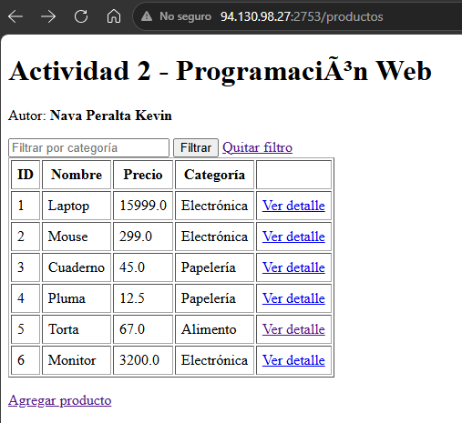
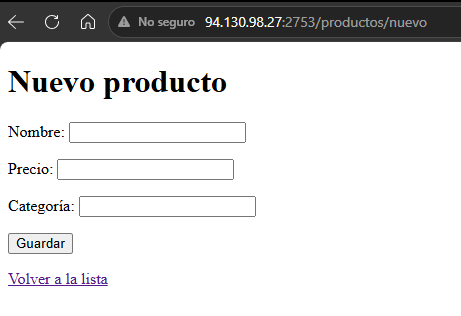
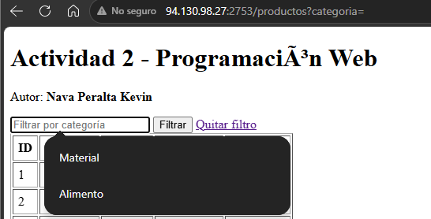
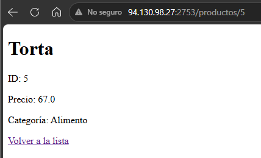
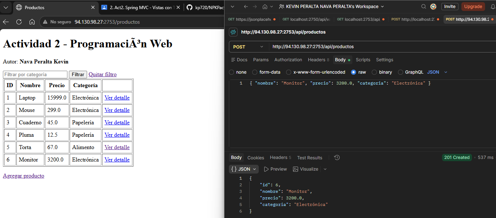

# Actividad 2 - Spring Boot MVC con Thymeleaf

- **Alumno:** Nava Peralta Kevin Peralta
- **Materia:** Programación Web

Proyecto de Spring Boot que usa el patrón MVC con vistas Thymeleaf, una clase DTO y un endpoint POST de tipo REST. 

## Enlaces

- **Repositorio de GitHub:** https://github.com/kp720/NPKPact2_t4
- **Proyecto en el VPS (puerto 2753):** http://94.130.98.27:2753/productos
- **Actividad 1 (sigue corriendo en su puerto original):** http://94.130.98.27:2750/nombre

## Qué incluye

| Requisito | Dónde está |
|---|---|
| DTO | `ProductoDTO` (id, nombre, precio, categoría) |
| Vista con lista (`Model` + `th:each`) | `lista.html` |
| Vista con formulario (`@ModelAttribute`) | `formulario.html` |
| `@RequestParam` | Filtro por categoría en `/productos?categoria=...` |
| `@PathVariable` | Detalle en `/productos/{id}` |
| `@Value` | Propiedades `app.autor` y `app.proyecto`, mostradas en la lista |
| POST REST con JSON | `POST /api/productos` |

## Endpoints

| Método | Ruta | Descripción |
|---|---|---|
| GET | `/productos` | Lista de productos (acepta `?categoria=`) |
| GET | `/productos/{id}` | Detalle de un producto |
| GET | `/productos/nuevo` | Formulario para agregar un producto |
| POST | `/productos/nuevo` | Recibe el formulario y guarda el producto |
| POST | `/api/productos` | Recibe un JSON con el DTO y responde `201` con el producto creado |

---

## Capturas de pantalla

### 1. Listado con `th:each`

### 2. Formulario con `@ModelAttribute`

### 3. Filtro con `@RequestParam`

### 4. Detalle con `@PathVariable`

### 5. Petición POST en Postman / Bruno

